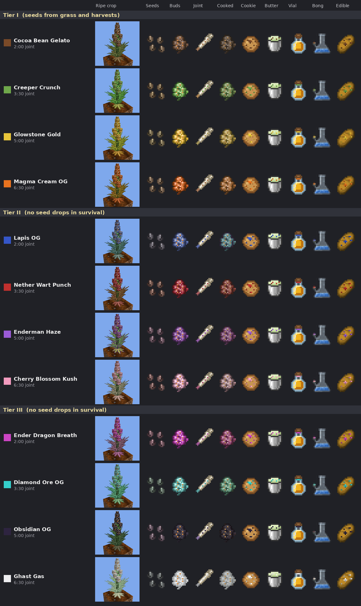
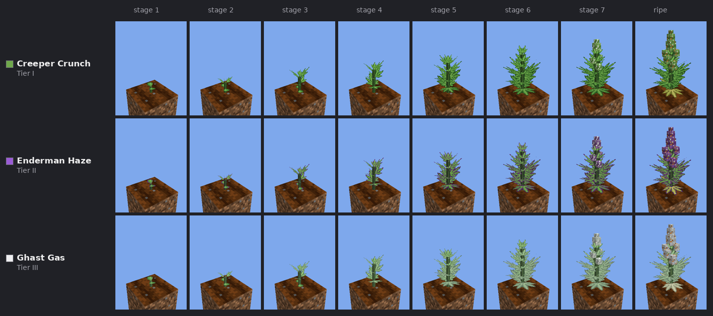
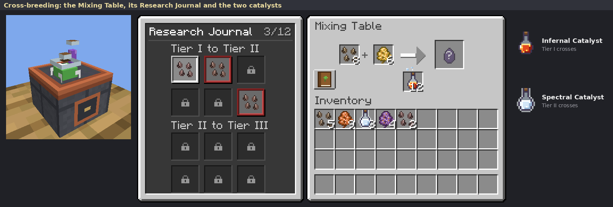
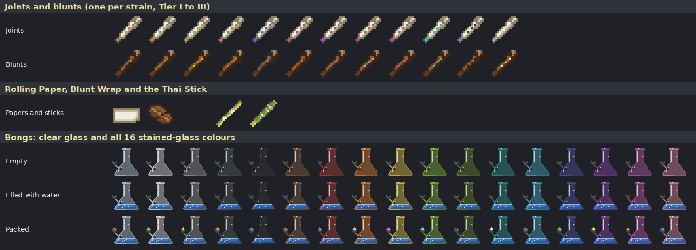
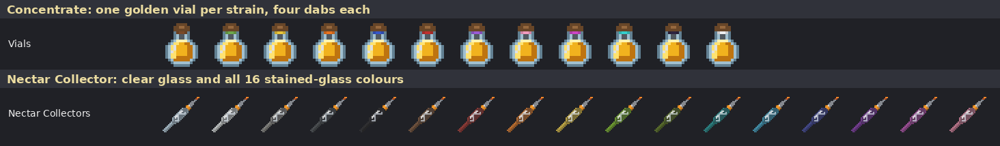
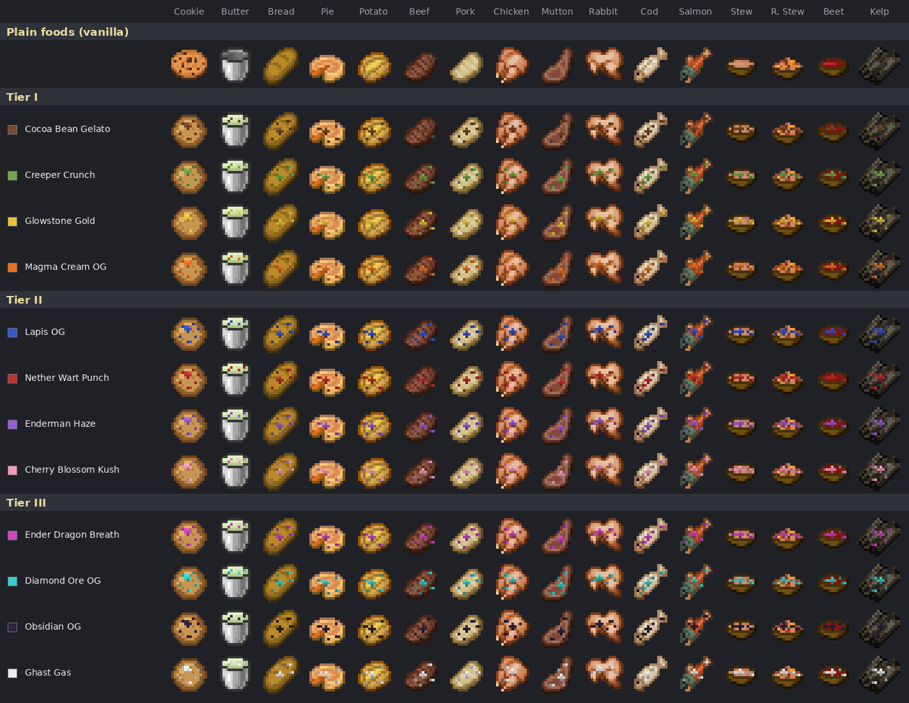

# Cannabis

**Grow it, roll it, cook it.** A vanilla-style cannabis farming mod for Minecraft Java Edition (Fabric).

Grow twelve strains in three tiers like wheat, then enjoy them the vanilla way: roll joints and blunts, pack a Thai Stick or a glass bong, brew golden concentrates and dab them with a Nectar Collector, or cook edibles in a furnace with Canna-Butter. Every hit gives a gentle buff, a subtle vignette and soft smoke that other players can see. Everything is made to look and feel like it shipped with the game.

**[⬇ Download the latest release](../../releases/latest)** · [Player guide](docs/GUIDE.md) · [Changelog](CHANGELOG.md) · [afkbird.com](https://afkbird.com/projects/cannabis/)

> This mod is a fictional game mechanic made for adult players. It does not endorse or encourage real-world drug use.

---

## Features

### Twelve strains in three tiers, grown like wheat

| Tier | Strains | Joint lasts | Effects | How to find it |
|---|---|---|---|---|
| I | 🟤 Cocoa Bean Gelato · 🟢 Creeper Crunch · 🟡 Glowstone Gold · 🟠 Magma Cream OG | 3:00 | Regeneration I, Resistance I | Seeds rarely drop from grass; ripe Tier I crops can drop other Tier I seeds |
| II | 🔵 Lapis OG · 🔴 Nether Wart Punch · 🟣 Enderman Haze · 🩷 Cherry Blossom Kush | 6:00 | Regeneration II, Resistance II | Cross-breeding at a Mixing Table |
| III | 🩵 Ender Dragon Breath · 🔷 Diamond Ore OG · ⚫ Obsidian OG · ⚪ Ghast Gas | 9:00 | Regeneration III, Resistance II | Cross-breeding at a Mixing Table |

Every strain also gives Night Vision. Higher-tier plants don't drop seeds, just like real high-grade cannabis. Each plant grows through eight real 3D stages to about 1.6 blocks tall, and ripe plants shed tiny drifting flecks so you know when to harvest. Bone meal won't rush them, but bees will.

### Cross-breeding at the Mixing Table

Tier II and Tier III seeds don't drop anywhere: you breed them. Load a Mixing Table with a seed of one strain, a bud of another strain from the same tier and a catalyst made from Nether ingredients, then click the faded seed to start. Thirty seconds later you have a seed of the next tier, and the table keeps going while your materials last.

* **Every pair works, but nothing tells you what it makes.** A cross you haven't made shows up as a mystery seed until it's finished. Finding out what each pair makes is up to you.
* **Two catalysts:** the Infernal Catalyst crosses Tier I strains, and the glowing Spectral Catalyst crosses Tier II strains.
* **Research Journal:** each table records the crosses it has made. Hover over one to see what it needs, and click it to load the table from your inventory. The journal stays with its table when you break and move it; a new table starts empty.

### Buds, Cooked Buds and Canna-Butter

Every strain has its own seeds, buds, Cooked Buds and Canna-Butter, shown in the overview at the top. Smelt buds into Cooked Buds and craft them with a Milk Bucket into Canna-Butter.

### Joints, blunts, Thai Sticks and glass bongs

* **Joints:** one bud and a Rolling Paper. Hold use for four seconds with a Flint and Steel in your inventory.
* **Blunts:** three Leaf Litter make a Blunt Wrap; add a bud and smoke it like a joint.
* **Thai Stick:** bamboo and string make the stick. Surround it with 8 buds of one tier in a crafting table, then take 8 hits, one bud each.
* **Bongs:** seven glass around a bowl, in clear glass or any of the 16 stained-glass colours. Fill one at a water source, pack it with a bud, and take five hits per bud. Other players see you hold it by the neck and hit it from the mouthpiece.

### Concentrates and the Nectar Collector

* **Concentrate:** brew a bud onto a Water Bottle to get a golden vial. Higher tiers give fewer but longer dabs: 4 of 5:00, 3 of 8:00 or 2 of 12:00.
* **Added effect:** brew a full vial again with a potion ingredient, such as Sugar or Blaze Powder, and every dab also gives that potion's effect.
* **Nectar Collector:** three glass on a diagonal, in any colour.

### Edibles

Put Canna-Butter in a furnace's fuel slot and cook ready-to-eat food: bread, steak, pie, stews and more. A bucket makes 6, 4 or 3 edibles by tier, lasting 4:00, 7:00 or 10:00 each. Infused food gives twice the plain food's hunger (with its normal saturation) and is marked with flecks in the strain's colour. Edibles can be eaten even on a full hunger bar: you still get the effect, and your hunger never goes past full.

### And more

* **Effects:** Regeneration, Resistance and Night Vision, with no HUD clutter.
  * A subtle vignette eases in and out.
  * Night Vision fades out smoothly instead of strobing.
* **Smoke and sound:** a haze of smoke and an exhale plume, plus a lighter click, crackle, bubbling, inhale and exhale. All the sounds are Minecraft's own.
* **Selling buds:** each Wandering Trader buys one strain of every tier for 1, 2 or 3 emeralds.
* **Two creative tabs:** Cannabis, and Cannabis Edibles for every infused food.
* **Server-friendly:** everything runs on the server, and the mod sends no custom network packets. Seed rarity is configurable.
* **Update notices:** when a new version is out, the game tells you on start-up. It only reads the newest version number from this page and never downloads anything itself.

The full rules, numbers and recipes are in the **[player guide](docs/GUIDE.md)**.

---

## Installing

| You need | Version |
|---|---|
| Minecraft Java Edition | 26.3 |
| [Fabric Loader](https://fabricmc.net/use/installer/) | 0.19.5 or newer |
| [Fabric API](https://modrinth.com/mod/fabric-api) | 0.162.0+26.3 or newer |
| Java | 25 or newer (bundled with the official launcher) |

1. Install Fabric Loader for Minecraft 26.3 with the Fabric installer.
2. Download `cannabis-<version>.jar` from the **[latest release](../../releases/latest)** and Fabric API from its page.
3. Put both jars into your `mods` folder (`%APPDATA%\.minecraft\mods` on Windows). Delete any older `cannabis-*.jar` first.
4. Start the game with the Fabric profile.

**Official downloads only come from this page's [Releases](../../releases).** Each release lists SHA-256 checksums in `SHA256SUMS.txt`, and every jar comes with the author's signature (`.sig`); see [SECURITY.md](SECURITY.md).

**Multiplayer:** the mod is required on the server **and** on every player's game, and everyone must run the same version. The server checks this when you join and turns away a different version, with a message saying which one to get. Worlds, items and planted crops carry over between versions.

### Staying up to date (Windows)

When a new version is out, the mod tells you on the title screen and in chat. To turn that off, set `"check_for_updates": false` in `config/cannabis.json`.

Every release includes **`cannabis-updater.zip`**. Unzip it anywhere and double-click **`update-cannabis.bat`** whenever there's an update, or just before you play:

* It checks GitHub for the newest version. If yours is older, it downloads it, checks it, and swaps it into your mods folder.
* Every official jar is **signed by the author**. The updater installs only a correctly signed jar and refuses anything else, even a file uploaded to this page by someone else.
* Your old jar is moved to a `cannabis-backup` folder, not deleted. If anything goes wrong, nothing is changed.
* **Servers:** put the two updater files in the server folder, next to `mods`, and run it while the server is stopped.
* **Prism Launcher and similar:** it can run automatically every time you press Play. See the `README.txt` inside the zip.

---

## Help and feedback

Found a bug or have an idea? [Open an issue](../../issues/new/choose), or ask in #mod-help on the [afkbird Discord](https://afkbird.com/discord). Include your mod version, and the game log if something crashed. Security problems: please report them privately ([SECURITY.md](SECURITY.md)).

## License

**Use it freely, just keep it pointing here.** You may play the mod, run it on any server (paid ones too), make and monetise videos and streams, put the official jar in modpacks, and tweak it privately for your own world. Credit the mod and link to this page. You may not publish modified versions, forks or ports, re-upload the jar on its own, sell it, or reuse its code or art without permission. Ideas, bug reports and permission requests (free or paid): [open an issue](../../issues/new/choose). The full terms are in [LICENSE](LICENSE).

## Credits

Made by [afkbird](https://afkbird.com), the studio of [AVIX-afk](https://github.com/AVIX-afk). All textures are original pixel art. Edibles and Canna-Butter draw an overlay on Minecraft's own sprites at runtime, and the sounds are Minecraft's own. No Mojang assets are included.

*Not an official Minecraft product. Not approved by or associated with Mojang or Microsoft.*
